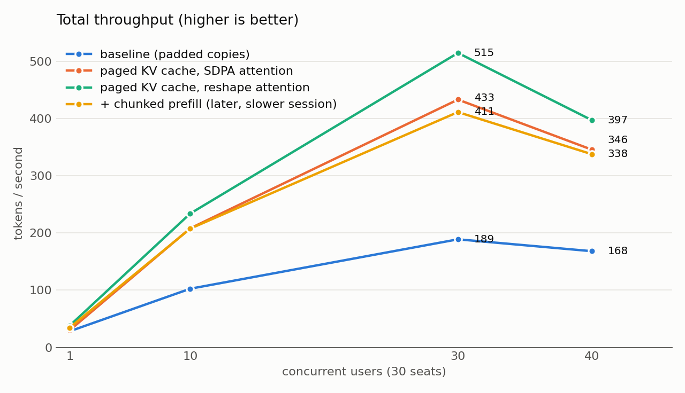
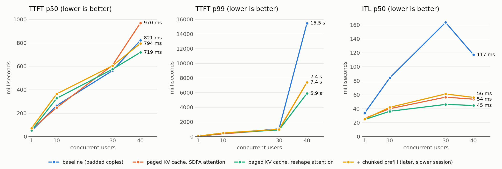
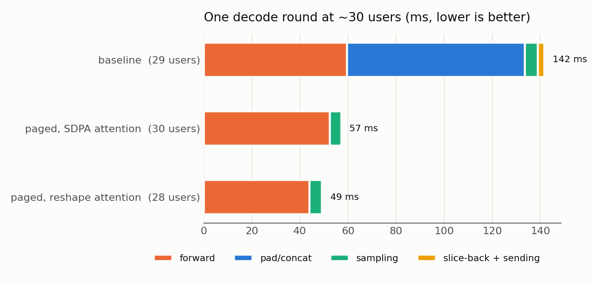
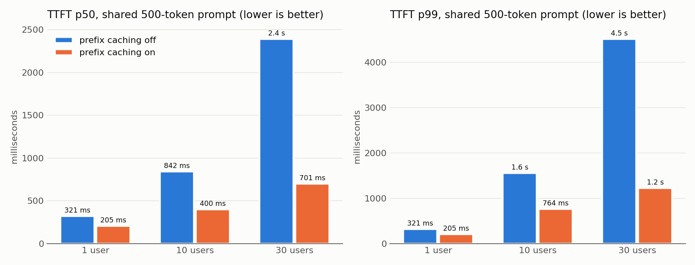
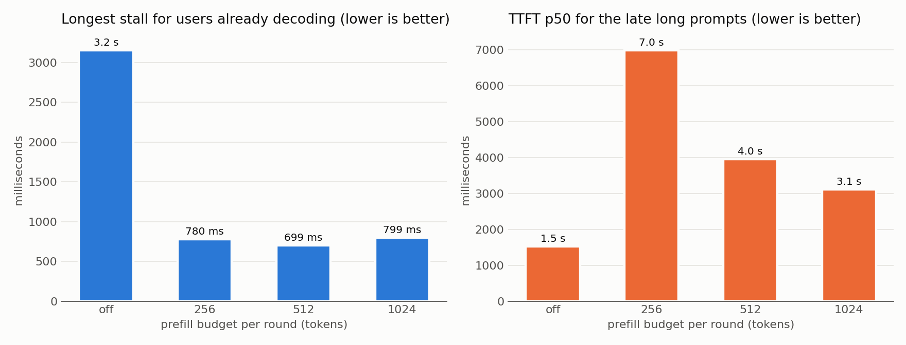

# nano-vLLM

A small LLM inference engine, built to understand how engines like vLLM work by
building the core ideas and measuring each one:

- an **OpenAI-compatible** `POST /v1/completions` endpoint that streams tokens
  over SSE;
- **continuous batching**: users join and leave between decode steps;
- **our own SmolLM2 forward pass** (RMSNorm, RoPE, GQA, SwiGLU), checked against
  Hugging Face;
- a **paged KV cache**: one shared pool of 16-token blocks, a block table per
  user, nothing re-padded or copied between steps;
- **prefix caching**: users whose prompts start the same share those blocks and
  skip prefilling them;
- **chunked prefill**: long prompts are read a slice per round, so users who
  are already generating keep getting tokens.

Every change is measured against a **baseline server** (`baseline_server.py`,
kept unchanged so it can be re-run) that keeps a separate KV cache per user and
pads all of them to the same length every decode step.

## Headline results

Apple M4, 16 GB, Mac GPU (MPS), SmolLM2-135M at fp32, each user asks for 100
tokens, at most 30 users decoding at once.

| | Baseline | nano-vLLM | Change |
|---|---|---|---|
| Total throughput, 30 users | 189 tok/s | **515 tok/s** | **2.7×** |
| One decode step, ~30 users | 132 ms | **48 ms** | 2.8× faster |
| Gap between tokens (ITL p50), 30 users | 164 ms | **46 ms** | 3.6× smaller |
| Throughput, 1 user | 28 tok/s | **38 tok/s** | 1.4× |
| TTFT p99, 40 users (10 wait for a seat) | 15.5 s | **5.9 s** | 2.6× smaller |
| TTFT p50, 30 users sharing a 500-token prompt | 2.4 s (caching off) | **0.70 s** (caching on) | 3.4× smaller |
| Longest stall for 20 decoding users when 10 long prompts arrive | 3.2 s (chunking off) | **0.70 s** (512-token chunks) | 4.5× shorter |





The yellow line (chunked prefill) was measured in a later session in which the
Mac ran slower overall: in that same session, the server with chunking turned
off reached 418 tok/s at 30 users, against 411 with it on. On these short
prompts chunking changes nothing; the gap to the green line is the session.

## How it works

```
 client ──POST /v1/completions──▶ FastAPI handler (event loop)
                                    │ tokenize, check the length
                                    ▼
                               waiting line ──▶ BatchEngine thread, one round at a time:
                                                 1. free the blocks of finished or disconnected users
                                                 2. seat users from the front of the line while a seat
                                                    and enough blocks for prompt + max_tokens are free;
                                                    reuse cached blocks for a known prompt prefix
                                                 3. prefill up to 512 prompt tokens: half-read prompts
                                                    first, then new users (only the uncached part)
                                                 4. decode one token for every user whose prompt is read
 client ◀──SSE, one token each── handler ◀──── tokens through an asyncio.Queue

 inside one decode step, for each of the 30 layers:
   new token ─▶ RMSNorm ─▶ Q, K, V ─▶ RoPE at position n
                                  ├─▶ write K, V into block table[n // 16], slot n % 16
                                  └─▶ gather every user's blocks (one gather per layer, short
                                      tables filled out with dummy block 0) ─▶ masked attention
                                      (query heads grouped onto their shared K/V head) ─▶ o_proj
                ─▶ RMSNorm ─▶ SwiGLU MLP
```

```
 shared pool (one K and one V tensor per layer: [blocks, 16, 3 KV heads, 64])
 ┌───┬───┬───┬───┬───┬───┬───┬───┬───┐
 │ 0 │ 1 │ 2 │ 3 │ 4 │ 5 │ 6 │ 7 │...│   block 0: dummy, never handed out
 └───┴───┴───┴───┴───┴───┴───┴───┴───┘
 user A table: [1, 2, 5]    user B table: [1, 2, 6]    ← both start with the same
                                                          32-token system prompt,
                                                          so blocks 1 and 2 are shared
```

| File | What it is |
|---|---|
| `server.py` | The API, the waiting line, and the paged `BatchEngine` |
| `model.py` | Our SmolLM2: plain forward pass, paged prefill, paged batched decode |
| `blocks.py` | `BlockAllocator` (free list, reference counts, prefix cache) and `KVPool` |
| `baseline_server.py` | The starting point, kept for comparisons |
| `bench.py` | Load test: N users at once, saves every token's arrival time |
| `profile_decode.py` | Times each part of one paged decode step |
| `plot.py` | Draws the charts in `docs/` from `results/` |
| `test_*.py` | Correctness checks (see below) |

## How to run it

```
python3 server.py
```

In a second terminal:

```
curl -N -X POST localhost:8080/v1/completions -H "Content-Type: application/json" \
     -d '{"prompt": "The cat sat on the", "max_tokens": 20}'
```

`python3 baseline_server.py` runs the baseline instead, on the same port, so
run only one at a time. `NANO_PREFIX_CACHE=0 python3 server.py` turns prefix
caching off, and `NANO_PREFILL_CHUNK=0` turns chunked prefill off (any other
number sets the prompt tokens read per round; the default is 512).

Load test (the server must be running), then redraw the charts:

```
nice -n 10 python3 bench.py --label my-run --users 1 10 30 40
nice -n 10 python3 bench.py --label shared --users 1 10 30 --system-repeats 35
nice -n 10 python3 bench.py --label late --users 20 --max-tokens 200 --late-users 10 --late-repeats 60
python3 plot.py
```

Tests, each printing what it compares:

```
python3 test_blocks.py      # allocator: toy pool, sharing, reviving, eviction
python3 test_kv_pool.py     # write path: values read back exactly through tables
python3 test_forward.py     # our forward pass against Hugging Face, piece by piece
python3 test_paged.py       # paged prefill/decode/prefix/chunks against Hugging Face
python3 test_engine.py      # the server's engine: greedy answers equal HF generate
```

## Where the time went

### Before: half of every step was rearranging the cache

The baseline's stopwatches (waiting for the GPU before each reading) showed
where one decode step goes:

| Part | 1 user | 10 users | 28 users |
|---|---|---|---|
| pad/concat | 7.9 (23%) | 23.0 (30%) | **65.8 (50%)** |
| forward | 23.4 (69%) | 48.3 (63%) | 58.1 (44%) |
| sampling | 2.3 | 4.0 | 6.0 |
| slice-back | 0.1 | 0.8 | 2.4 |
| sending | 0.01 | 0.01 | 0.02 |
| whole step | 33.7 | 76.2 | 132.3 |

At 30 users, every step padded each user's K and V separately in every layer:
1,800 pads and 60 concatenates, all to build a rectangle that was thrown away
after one step. Slicing back was almost free because slicing makes a view, not
a copy.

### After: no cache rearranging, and faster attention



1. **Paged KV cache** (58 ms per step). K and V are written once into their
   block and never moved. A step does one gather per layer for K and one for V,
   whatever the number of users.
2. **Attention by reshape instead of SDPA** (48 ms). On MPS, PyTorch's SDPA
   with a mask and grouped heads took 3.3–3.5× longer than a plain
   matmul-softmax-matmul where each group of 3 query heads is reshaped onto its
   shared K/V head (no copy). Same results to 6e-7.

### What is left: attention grows with users × context

`profile_decode.py` with every part timed separately:

| Users | Context | Step | norm+QKV+RoPE | write | gather | attention | o_proj+MLP |
|---|---|---|---|---|---|---|---|
| 1 | 64 | 19 ms | 11.6 | 6.0 | 6.4 | 8.5 | 13.6 |
| 28 | 64 | 39 ms | 13.8 | 6.0 | 13.2 | 16.8 | 18.0 |
| 28 | 512 | 180–190 ms | 13.7 | 6.1 | 45.4 | 134.1 | 16.7 |

(The parts add up to more than the step because of the extra GPU waits.)

- **With 1 user, the step is mostly fixed overhead.** Reading all 540 MB of
  weights at about 120 GB/s takes about 4.5 ms, but the step takes 19 ms: about
  30 layers × ~20 small GPU operations, each with a launch cost. Paging cannot
  fix that; fusing operations (or CUDA graphs on NVIDIA) would.
- **With long contexts, the gather and attention dominate.** A step costs about
  13–14 ms per 1,000 user-tokens, the same for 30 × 540, 16 × 1,000 and
  8 × 2,000. The gather is still a copy: real vLLM's PagedAttention kernel reads
  blocks in place, which needs a custom GPU kernel.
- **Shared prompt blocks are gathered once per user.** With a 500-token shared
  system prompt, 30 users gather the same blocks 30 times every step, so
  prefix caching helps prefill (TTFT) but not decode.

### Prefix caching



Every user sends the same ~500-token system prompt plus their own question.
With caching on, the first user prefills everything; everyone after reuses the
cached full blocks and prefills only the last block and their question.

| Users | TTFT p50 off | TTFT p50 on | TTFT p99 off | TTFT p99 on |
|---|---|---|---|---|
| 1 | 321 ms | 205 ms | 321 ms | 205 ms |
| 10 | 842 ms | 400 ms | 1.56 s | 764 ms |
| 30 | 2.39 s | **701 ms** | 4.51 s | **1.22 s** |

### Chunked prefill



The test: 20 users start generating 200 tokens each; 2 s later, 10 more users
arrive, each with their own 904-token prompt (no shared prefix). Without
chunking, the round that reads those prompts reads all 9,040 tokens before
anyone gets another token.

| Prompt tokens read per round | Longest stall (early users) | ITL p99 (early users) | TTFT p50 (late users) | TTFT p99 (late users) |
|---|---|---|---|---|
| no limit | 3,157 ms | 469 ms | 1.5 s | 2.8 s |
| 256 | 780 ms | 676 ms | 7.0 s | 15.1 s |
| **512 (default)** | **699 ms** | 599 ms | 4.0 s | 8.7 s |
| 1,024 | 799 ms | 772 ms | 3.1 s | 6.0 s |

- **It is a trade, not a free win.** Chunking cuts the worst freeze for users
  who are already reading by 4.5×, but the people with long prompts wait longer
  for their first token, because every round also has to decode all 20 early
  users while moving the long prompts forward only a slice.
- **The stall does not shrink below ~700 ms** even with small slices: each
  round also decodes 30 users whose contexts reach 900 tokens, and that decode
  step (attention over users × context) is now the bigger part of a round.
- **The ITL p99 got worse** (469 → 599 ms) while the single worst gap got much
  better: chunking spreads one 3-second freeze over many slower rounds.

## Correctness

Speed means nothing if the answers change, so every step has a test that
compares against Hugging Face with sampling turned off:

| Test | What it proves | Result |
|---|---|---|
| `test_forward.py` | Each piece of our model (RMSNorm, RoPE, attention, MLP) and the full logits equal HF's | 0 difference on CPU, ≤ 2.1e-5 on MPS |
| `test_paged.py` | Paged prefill and decode, teacher-forced across block boundaries, 1 user and 4 users of different lengths (one joining late), with the pool **filled with garbage** first | Same tokens as HF everywhere, logits within 3.5e-4 |
| `test_paged.py` (prefix) | A user reusing another user's cached blocks still matches HF | Same tokens, logits within 9e-5 |
| `test_paged.py` (chunks) | A 90-token prompt read 7 tokens at a time, across every block boundary, matches HF at the end of every chunk and through decode | Same tokens, logits within 1.1e-4 |
| `test_engine.py` | The server's engine gives exactly HF `generate`'s greedy answers, with a big pool, a pool so small users must wait, 8-token chunks and 512-token chunks | 7 of 7 prompts identical in all four |
| `test_blocks.py`, `test_kv_pool.py` | Tables, free lists and reference counts after every step; values read back exactly | All asserts pass |

Two lessons from testing:

- **Comparing only the chosen token hides bugs.** RoPE broken on purpose
  (theta 10,000 instead of 100,000) moved the logits by 1.49 but **kept the same
  top token**. The tests compare logits.
- **The garbage pool proves the mask works.** Masked slots get weight 0, so
  huge garbage values there change nothing (0 × garbage = 0). NaN would not
  work as garbage: 0 × NaN is still NaN.

## Decision log

| # | Question | My decision | Why |
|---|---|---|---|
| 1 | Where to start | The baseline server, unchanged | It already has the API, SSE and continuous batching; the project is about the engine inside |
| 2 | What to do first | **Measure a baseline** before changing anything | Without a "before" number, no change can be proven |
| 3 | Largest load test | **40 users** | 60 users made the Mac hang; 40 still tests the waiting line (30 seats) |
| 4 | Model | **SmolLM2-135M** at fp32 instead of distilgpt2 | distilgpt2 (2019) is an old design. SmolLM2 has the modern Llama design (RoPE, GQA, RMSNorm, SwiGLU), is barely bigger, and writes far better English |
| 5 | Context limit | **1,024 tokens**, our own setting | SmolLM2 allows 8,192, but 1,024 keeps the comparison with distilgpt2 fair and memory small |
| 6 | How to find the slow part | **Stopwatches** around each part of a decode step, waiting for the GPU before each reading | The GPU runs in the background; without waiting, the forward time would hide inside sampling |
| 7 | How to remove the pad/concat cost | **Write our own SmolLM2 forward pass** (option B) instead of refilling Hugging Face's cache every step (option A) | We control every copy, it is what vLLM does, and it is the only way to attack the 1-user forward overhead later |
| 8 | How attention reads a paged cache | One shared pool of 16-token blocks, one block table per user, tables filled out with a reserved **dummy block 0**, **one gather per layer** for K and one for V, and a mask that hides dummy and unused slots | 60 gathers per step whatever the number of users, instead of 1,800 pads and 60 concatenates. Honest limit: the gather is still a copy |
| 9 | How attention handles GQA (9 query heads, 3 K/V heads) in prefill | **SDPA with `enable_gqa=True`** instead of copying K/V 3× with `repeat_kv` | One call and no copy written by us. Measured on MPS: about the same speed as `repeat_kv`. Later replaced for paged attention (decision 14) |
| 10 | How big the block pool is | **A setting**, default **1,920 blocks** (30 users × 1,024 tokens, 1.32 GiB) | The server never runs out at the default, and tests use a tiny pool to force the "pool full" case |
| 11 | What the allocator does when it can't satisfy a request | **All or nothing**: it raises `PoolFull` and hands out no blocks; a bad free also changes nothing | A half-seated user or a half-freed list would leave the pool in a state nobody can reason about |
| 12 | Shape of the pool | One K and one V tensor per layer, **`[blocks, block_size, kv_heads, head_dim]`**; token `n` lives in block `table[n // 16]`, slot `n % 16` | After a gather, `blocks × block_size` merge into one token axis for free, and swapping heads and tokens is only a view |
| 13 | When the pool is full | **Reserve at the door**: a user is seated only if blocks for `prompt + max_tokens` are free; otherwise they wait at the front of the line | It can never run out in the middle of a step, so no user has to be evicted and recomputed. It wastes blocks when answers end early; vLLM's preemption is the upgrade |
| 14 | Attention in paged prefill and decode | **Matmul-softmax-matmul, with each group of query heads reshaped onto its K/V head**, instead of SDPA | Measured on MPS: 3.3–3.5× faster than SDPA with a mask, same results to 6e-7; took a step at 30 users from 58 ms to 48 ms |
| 15 | Test tolerance for paged decode | **5e-4 on CPU, 1e-3 on MPS**, plus "same token at every step" | Hugging Face's own step-by-step decoding differs from its own full forward by 1e-4; logits reach about 40, so 3e-4 is a relative error of about 1e-5 |
| 16 | What prefix caching shares | **Full 16-token prompt blocks**, found by a chained hash (each block's fingerprint covers every token before it), with reference counts; the **last prompt token is always recomputed** | A chained hash means a match always covers the whole prefix. The last token must be computed to get its logits. Decode never writes into a full prompt block, so shared blocks are never changed |
| 17 | What happens to a cached block when its users leave | It goes back to the free list **but keeps its fingerprint**, and is revived if someone asks for it before it is handed out again | Free memory doubles as a cache at no cost; reuse order is oldest freed first |
| 18 | When users arrive together | **Seat and prefill them one at a time** | Otherwise everyone arriving in the same moment would look up the cache before anyone had filled it, and nobody would share |
| 19 | Seats | **Keep 30** | Not re-measured for the paged engine; 30 users fit easily in the pool, and keeping the cap makes every before/after comparison fair |
| 20 | How chunked prefill shares a round | A **budget of prompt tokens per round**; half-read prompts go first, and new users are seated only while budget is left; each chunk's full blocks are added to the prefix cache right away | Half-read prompts first means nobody is overtaken forever. Registering after every chunk keeps prefix caching working: a user seated in a later round reuses the blocks the first user has already read |
| 21 | Budget size | **512 tokens** (setting `NANO_PREFILL_CHUNK`, 0 = no limit) | Measured 256, 512 and 1,024: 512 gave the shortest worst stall (699 ms) and the best ITL p99 of the three, with a middle cost to the late users' TTFT |

## Limits

- A tiny model (135M) on a Mac GPU, fp32, one machine, no tensor parallelism,
  no quantization.
- The paged attention is a gather plus plain PyTorch operations, not a fused
  GPU kernel, so the gather is still a copy and long contexts cost about
  13–14 ms per 1,000 user-tokens per step.
- New users are prefilled one at a time (one forward pass each, even inside the
  same round), so TTFT grows with the number of users arriving together
  (575 ms p50 for 30 at once).
- Chunked prefill trades the late users' TTFT for the early users' smoothness;
  the budget is fixed, not adapted to the load.
- Reserving `prompt + max_tokens` at the door wastes blocks when answers stop
  early; there is no preemption.
- Measurements on MPS vary between runs (the same decode step measured 98 ms
  and 190 ms in different sessions); compare runs from the same session.
- The load test client runs on the same Mac as the server.
- No live metrics endpoint: the numbers come from `bench.py` and the server's
  stopwatch reports.

## Next steps

1. **Batched prefill**: prefill everyone who arrives together in one forward
   pass (with a token budget) to cut TTFT.
2. **Preemption** instead of reserving `max_tokens` up front.
3. **A real paged attention kernel** (Metal or Triton on NVIDIA) that reads
   blocks in place, so shared prefix blocks are read once, not gathered per user.
4. **A `/metrics` endpoint** with TTFT, ITL, batch size and free blocks while the
   server runs.
